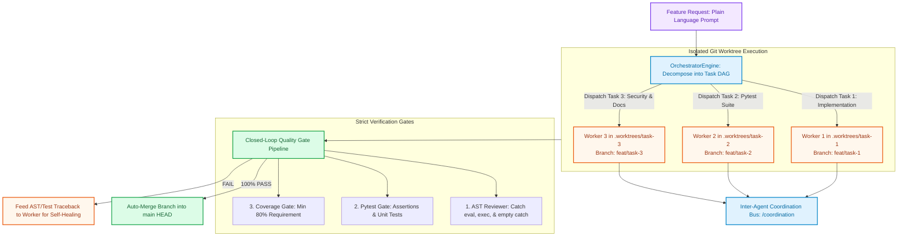

# 🚀 Agent Fleet Orchestrator

<p align="center">
  
  
  
  
  
  
</p>

> **Build the Leverage System, Not Just an App**

An enterprise-grade multi-agent fleet orchestration engine that decomposes natural language feature requests into task Directed Acyclic Graphs (DAGs), executes them concurrently across isolated git worktrees (`.worktrees/task-<id>`), and enforces 100% closed-loop quality gates (AST inspection, pytest coverage, and semantic evaluation) before auto-merging branches into `main`.

---

## 🎨 System Architecture & Workflow



---

## 🌟 Key Features

1. **Autonomous Task DAG Decomposition**:
   - Decomposes high-level requirements into interdependent tasks (`implement`, `test`, `review`, `document`).
   - Automatically resolves dependency graphs and dispatches independent sub-tasks concurrently.

2. **Zero-Collision Git Worktree Isolation**:
   - Every worker executes inside its own physical `.worktrees/task-<id>` sandbox on a dedicated git branch (`feat/task-<id>`).
   - Completely eliminates concurrent filesystem locks, dirty working trees, and merge collisions.

3. **Closed-Loop Quality Gate Pipeline (Zero Open-Loop Merges)**:
   - **AST Review Gate**: Synthesizes Abstract Syntax Trees to catch security violations (`eval`, `exec`), missing docstrings, and swallowed exceptions (`except Exception: pass`).
   - **Test & Coverage Gate**: Runs `pytest` and enforces `>= 80%` test coverage before merge approval.
   - **Eval Gate**: Verifies semantic accuracy against project specifications.

4. **Model Context Protocol (MCP) Integration**:
   - `project-context`: Custom FastMCP server serving repository constraints and schemas to agents.
   - `eval-runner`: FastMCP tool allowing agent workers to self-evaluate pre-merge.

5. **Multi-Provider LiteLLM Routing**:
   - Intelligent cost/latency model routing supporting OpenAI, Anthropic Claude, Google Gemini, and local **Ollama** models via `config/models.yaml`.

6. **Web Control Plane & Typer CLI**:
   - Real-time Bootstrap + FastAPI web dashboard with live execution graphs and task telemetry.
   - Rich CLI for standalone daemon runs and worktree inspections.

---

## ⚙️ Environment Variables Setup

Create a `.env` file in the root directory (or use `.env.example`):

```env
# AI Model Providers (Configure at least one)
OPENAI_API_KEY=your_openai_key_here
ANTHROPIC_API_KEY=your_anthropic_key_here
GEMINI_API_KEY=your_gemini_key_here

# Local Model Inference (Optional)
OLLAMA_BASE_URL=http://localhost:11434

# Orchestrator Settings
MAX_PARALLEL_WORKERS=4
DEFAULT_AGENT_TYPE=mock_agent  # Options: mock_agent, aider, claude_code, cline
QUALITY_GATE_COVERAGE_MIN=80
```

---

## 🚀 Quickstart Guide

### 1. Install Dependencies
```bash
python -m venv venv
.\venv\Scripts\activate  # On Linux/macOS: source venv/bin/activate
pip install -r requirements.txt
```

### 2. Run Feature Orchestration via CLI
```bash
python cli.py run --title "JWT Authentication Service" --description "Implement JWT login, token refresh endpoints, and unit tests."
```

### 3. Inspect Active Worktrees & Agent Coordination
```bash
python cli.py worktrees
python cli.py coordination
```

### 4. Launch Interactive Web Dashboard
```bash
python cli.py dashboard --port 8000
```
Navigate to `http://localhost:8000` to inspect live execution graphs, worktree status, and quality gate reports.

### 5. Run Full Verification Suite
```bash
python -m pytest tests/ -v
```
