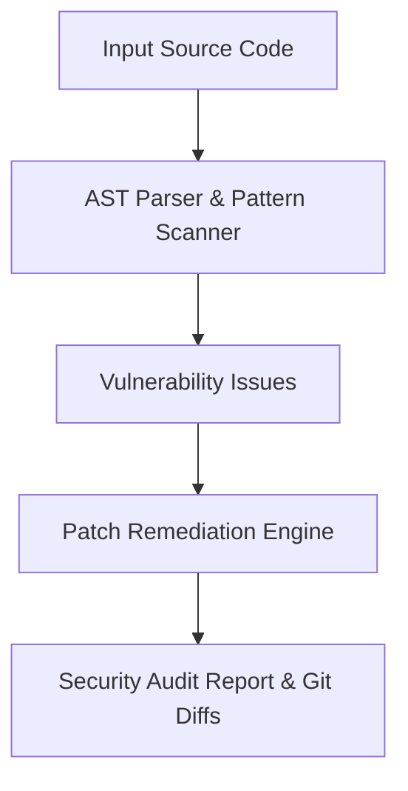

# AI Code Security & Review Sentinel

> **Autonomously Built by Agent Fleet Orchestrator**

The **AI Code Security & Review Sentinel** is a static security analysis and defensive remediation engine designed to detect OWASP vulnerabilities, hardcoded secrets, and dynamic execution hazards in software codebases.

---

## Vulnerability Taxonomy & Detection Engine

| Vulnerability ID | Severity | Category | Remediation Pattern |
|---|---|---|---|
| `DYNAMIC_EXEC` | HIGH | OWASP A03: Injection | Replace `eval()` / `exec()` with `ast.literal_eval()` or safe mapping logic. |
| `UNSAFE_SUBPROCESS` | HIGH | OWASP A03: Command Injection | Enforce `shell=False` and pass argument vectors as string arrays. |
| `HARDCODED_SECRET` | HIGH | OWASP A07: Security Misconfig | Extract credentials to environment variables (`os.environ`). |

---

## Architectural Workflow

