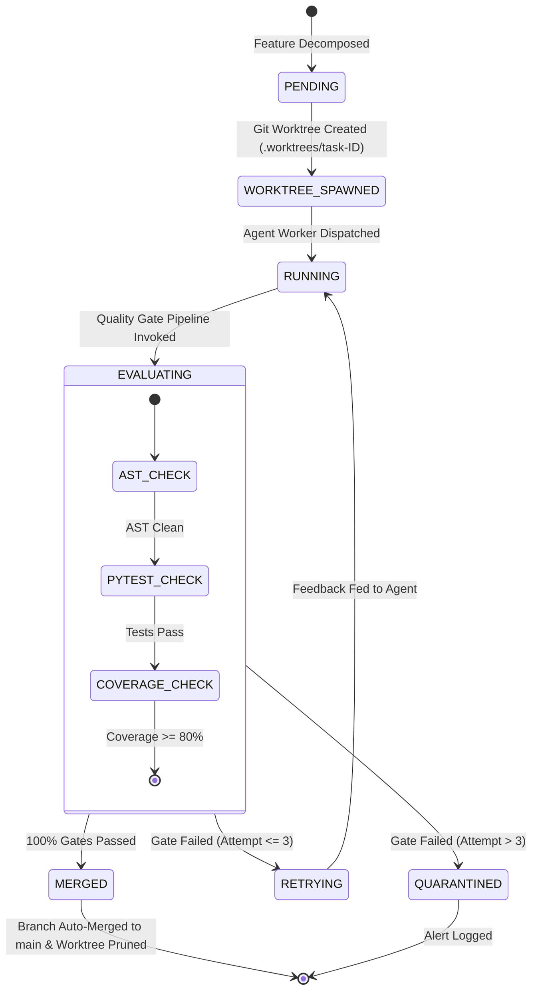

# 🏛️ Agent Fleet Orchestrator — Architecture Deep Dive

This document details the internal architecture, task lifecycle, git worktree isolation mechanism, and closed-loop verification pipeline powering `agent-fleet-orchestrator`.

---

## 1. Core Component Map

```
agent-fleet-orchestrator/
├── core/
│   ├── orchestrator.py     # Task DAG decomposition, scheduling, and lifecycle loops
│   └── schemas.py          # Pydantic v2 schemas for Tasks, TaskGraphs, Gates, and Messages
├── worktrees/
│   └── manager.py          # Git worktree lifecycle (.worktrees/task-*) and /coordination bus
├── gates/
│   ├── pipeline.py         # Multi-gate aggregator executing AST, pytest, and coverage checks
│   ├── ast_reviewer.py     # Python AST scanner for anti-patterns (eval, exec, silent catches)
│   └── coverage_gate.py    # Coverage report parser enforcing >= 80% coverage
├── models/
│   └── router.py           # LiteLLM multi-provider model selector based on TaskRole
├── mcp/
│   ├── project_context.py  # FastMCP server exposing project schemas & rules to agents
│   └── eval_runner.py      # FastMCP server allowing agents to self-evaluate pre-merge
└── dashboard/              # FastAPI + Bootstrap live monitoring control plane
```

---

## 2. Task Lifecycle State Machine



---

## 3. Defensive Quality Gate Specifications

1. **AST Review Gate (`gates/ast_reviewer.py`)**:
   - Parses python source files into Abstract Syntax Trees using Python's built-in `ast` module.
   - Forbids all `ast.Call` nodes invoking `eval()`, `exec()`, or `__import__()`.
   - Flags `ast.Try` blocks where `handler.body` contains only `ast.Pass` without logging or re-raise.

2. **Pytest & Coverage Gate (`gates/coverage_gate.py`)**:
   - Runs `pytest --cov --cov-report=json` inside the isolated worktree.
   - Parses the resulting coverage JSON and blocks merge if statement coverage is below threshold.
